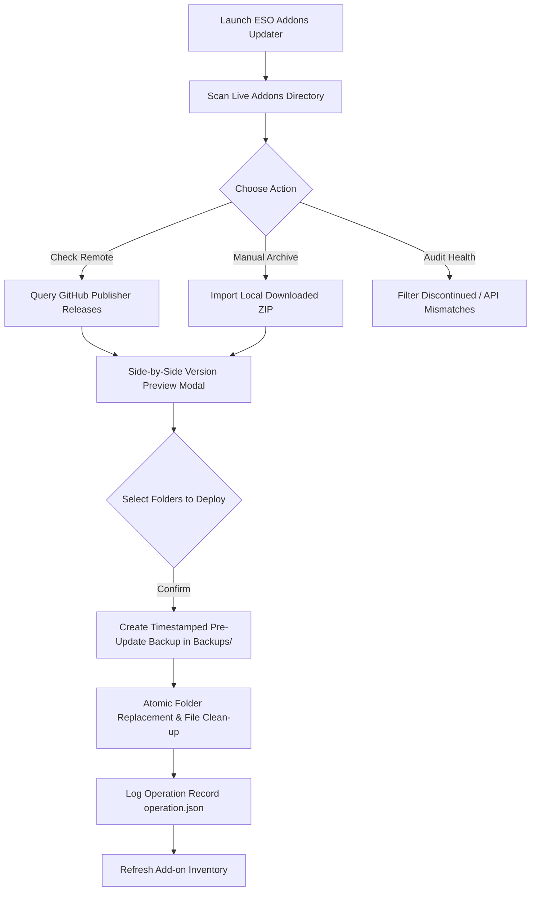

# ESO Addons Updater

[](https://www.python.org/)
[](https://www.microsoft.com/windows)
[](https://github.com/TomSchimansky/CustomTkinter)
[](LICENSE)
[](#)

> **Elder Scrolls Online Add-on Manager, Release Tracker & Reversible Deployment Engine.**  
> *Inspect, audit, update, and restore Elder Scrolls Online add-ons with automated safety backups and manifest conflict analysis.*

---

## 1. Project Overview

**ESO Addons Updater** is a specialised desktop management utility developed for Windows to administer, audit, and update *The Elder Scrolls Online* (ESO) add-on installations safely.

While community tools such as Minion serve general catalogue updates, modern add-on management presents unique challenges:
- **Terms-Compliant Operation:** MMOUI and ESOUI explicitly prohibit automated catalogue scraping. ESO Addons Updater fully respects platform terms of service by tracking public publisher GitHub repositories (e.g. `CharacterMarkdown`) for direct release assets and providing an interactive local ZIP inspection pipeline for manually downloaded archives.
- **Vortex Symlink & Deployment Safeguards:** Folders deployed or hardlinked via Nexus Vortex are automatically detected via `__folder_managed_by_vortex` markers and `vortex.deployment.json`, preventing destructive overwriting or desynchronisation of mod-managed directories.
- **Safety-First Atomic Replacement:** Every package deployment creates a complete, timestamped pre-update snapshot under `Backups/` accompanied by an `operation.json` transaction record. In the event of an upstream regression, previous versions can be restored instantly without compromising character `SavedVariables`.
- **Manifest & Dependency Auditing:** Direct parsing of `.addon` / `.txt` metadata declarations enables detection of discontinued listings, missing library dependencies (e.g. LibLazyCrafting version mismatches), and outdated `APIVersion` declarations relative to the live game client.

---

## 2. Key Features

- **Live Add-on Directory Inspection:**  
  Scans active ESO add-on directories (`live\Addons`), indexing folder names, manifest titles, version numbers (`Version` and `AddOnVersion`), API declarations (`APIVersion`), declared dependencies (`DependsOn`), and optional dependencies (`OptionalDependsOn`).

- **Direct GitHub Release Tracking:**  
  Monitors designated publisher GitHub repositories for official releases. Automatically evaluates SemVer / release tags and offers one-click package archive inspection and staging.

- **Side-by-Side Archive Preview:**  
  Inspects incoming ZIP archives in a dedicated preview modal prior to writing changes to disk. Clearly contrasts incoming folder names and package versions against currently installed editions, highlighting unmanaged or conflicting files.

- **Reversible Backup & Restore Engine:**  
  Archives existing targeted add-on directories prior to extracting new files. Each operation generates a timestamped directory containing the original folders and an `operation.json` audit manifest.

- **SavedVariables Firewall:**  
  Refuses to scan, preview or write unless the configured folder is an `AddOns` directory. A parent folder such as `live`, any path through `SavedVariables`, and any backup location inside `SavedVariables` are rejected before anything is touched, so character data stays out of every operation.

- **Game-Running Warning:**  
  Before applying a package, checks whether `eso64.exe` is running. If it is, a warning asks you to confirm (the default answer is No) and keeps the preview open, so you can close the game and try again.

- **Discontinued & Deprecation Review Filters:**  
  Cross-references installed add-ons against ESOUI's *Discontinued & Outdated* catalogued listings (e.g. `CritPercent`, `ESO-Database Export`, `MundusMap`), recommending cleanup when appropriate.

- **Live Game API Compatibility Checker:**  
  Enables players to input their live game API version (retrieved in-game via `/script d(GetAPIVersion())`) to pinpoint add-ons requiring maintenance or updated manifests.

- **Modern CustomTkinter GUI:**  
  Fluid, responsive Windows 10/11 native presentation featuring dark and light theme adaptability, structured data grids, asynchronous release fetching, and real-time operation status reporting.

---

## 3. Architecture & Repository Layout

```text
C:\Addons Updater\
├── addons_updater.py             # Core Python application and UI engine
├── config.example.json           # Generic configuration schema template
├── release_sources.example.json  # Publisher GitHub source mapping template
├── requirements-updater.txt      # Python runtime dependencies
├── Run-Addons-Updater.bat        # Production launcher batch script
├── LICENSE                       # Proprietary copyright and licensing terms
├── CHANGELOG.md                  # Release history
└── README.md                     # Comprehensive project documentation
```

### Configuration Files (Local State)

Local machine paths and private source mappings are sanitised from version control via `.gitignore`:
- `config.json`: Defines the local ESO AddOns path on disk (e.g. `C:\Users\<username>\Documents\Elder Scrolls Online\live\Addons`).
- `release_sources.json`: Stores user-mapped custom GitHub repositories for specific add-ons.
- `Backups/`: Contains local timestamped backups and `operation.json` snapshots.

---

## 4. Prerequisites & Installation

### System Requirements
- **Operating System:** Windows 10 or Windows 11 (64-bit).
- **Python:** Python 3.11+ installed.
- **Game Installation:** Elder Scrolls Online with standard `live\Addons` directory structure.

### Setup Instructions

1. **Clone or Download the Repository:**
   ```powershell
   git clone https://github.com/hawkers63/Addons-Updater.git "C:\Addons Updater"
   cd "C:\Addons Updater"
   ```

2. **Establish Local Configuration:**
   Copy `config.example.json` to `config.json` and adjust the path to point to your live add-on directory:
   ```powershell
   Copy-Item config.example.json config.json
   ```

3. **Install Dependencies:**
   ```powershell
   pip install -r requirements-updater.txt
   ```

---

## 5. Usage & Operational Workflow

### Launching the Application
Execute the packaged batch launcher:
```powershell
.\Run-Addons-Updater.bat
```
The launcher expects Python 3.11 installed per user at `%LOCALAPPDATA%\Programs\Python\Python311`, with the packages from `requirements-updater.txt`. With any other Python 3.11+ installation, launch via Python instead:
```powershell
pythonw addons_updater.py
```

### Operational Workflow



1. **Scan Folder:** Click **Scan folder** to catalogue all installed folders in your live add-on directory.
2. **Check GitHub Releases:** Click **Check GitHub releases** to query publisher repositories for stable updates with downloadable asset archives.
3. **Import ZIP:** For add-ons downloaded from publisher sites or ESOUI, click **Import ZIP…** and select the archive.
4. **Inspect & Apply:** Review the package version against the installed version in the preview dialogue. Select eligible folders and click **Back up and apply**. If the game is running, you are asked to confirm first.
5. **Review Outdated Add-ons:** Activate the **Review** filter to inspect deprecated listings, discontinued projects, or libraries with unmet version requirements.

---

## 6. Restoration & Rollback Guide

Should an updated add-on cause an in-game issue or script error:
1. Close *The Elder Scrolls Online* and any open add-on utilities.
2. In the updater toolbar, click **Backups** to open the `Backups/` directory.
3. Open the dated backup folder corresponding to the operation. Inspect `operation.json`: it records the app version, confirms that `SavedVariables` was isolated, and lists each folder with its action and previous version (`Version` and `AddOnVersion`). Backups made before version 1.1.0 omit the first two fields and the previous `AddOnVersion`.
4. Delete or move the problematic add-on folder out of your live `AddOns` directory.
5. Copy the pristine original folder from the backup folder directly back into your live `AddOns` directory.
6. Note: Character data and add-on configurations stored in `SavedVariables` remain untouched.

---

## 7. Configuration Reference

### `config.json`
```json
{
  "addons_dir": "C:\\Users\\<username>\\Documents\\Elder Scrolls Online\\live\\Addons"
}
```
* **`addons_dir`** *(string)*: Absolute path to the active `AddOns` directory. It must be the `AddOns` folder itself, not its parent (such as `live`); the updater refuses any other folder, and any path through `SavedVariables`.

### `release_sources.json`
```json
{
  "charactermarkdown": "solaegis/CharacterMarkdown"
}
```
* Key: Add-on folder name (lowercase).
* Value: GitHub repository in `owner/repo` format.

---

## 8. Copyright & Proprietary Licence

**Proprietary — Copyright (c) 2026 Mark Hawksworth (hawkers63). All Rights Reserved.**

This software, including source code, design architecture, and documentation, is proprietary intellectual property. Unauthorised copying, distribution, modification, public display, reverse engineering, or commercial use without prior written consent is strictly prohibited.

For complete terms, consult the [LICENSE](LICENSE) file.
